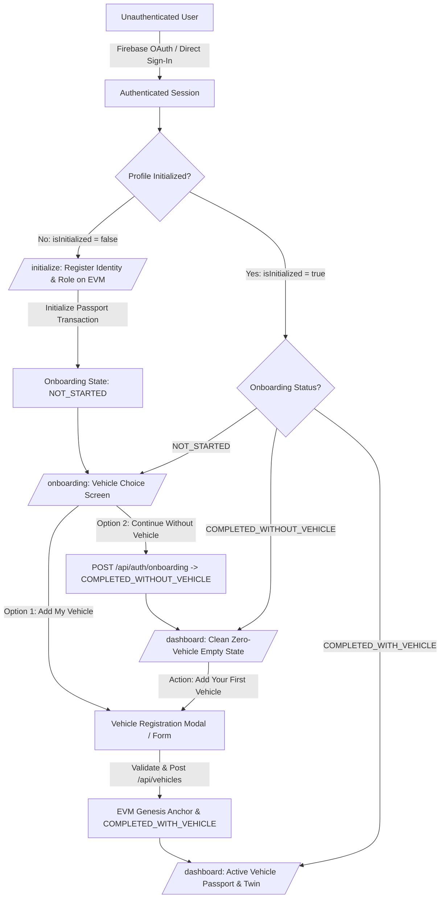

# Digital Vehicle Passport — New-User Onboarding & Vehicle Initialization Flow

## 1. Architectural Overview & State Machine

The Blockchain-Based Digital Vehicle Passport implements a decoupled, event-driven state machine separating **Authentication**, **Blockchain User Registration**, and **Vehicle Asset Ownership**.

Under no circumstances does authenticating into the platform imply that a vehicle asset exists or that a vehicle passport is automatically minted.

---

## 2. Onboarding Lifecycle States

The data model uses the PostgreSQL enum `OnboardingStatus`:

| State | Definition | Next Route | Vehicle Required? |
| :--- | :--- | :--- | :--- |
| `NOT_STARTED` | New account whose blockchain user identity is provisioned, but has not made an automotive passport choice. | `/onboarding` | No |
| `COMPLETED_WITHOUT_VEHICLE` | Verified user who explicitly chose to explore the platform without anchoring a vehicle. | `/dashboard` | No (0 vehicles) |
| `COMPLETED_WITH_VEHICLE` | Verified user who owns and anchored at least one cryptographic vehicle passport. | `/dashboard` | Yes (>= 1 vehicles) |

---

## 3. Step-by-Step User Journey

### Flow A: New User Registers & Continues Without a Vehicle

1. **Sign Up / Direct Sign-In**:
   - The user inputs email and full name on `/login`.
   - Backend creates user in PostgreSQL with `isInitialized: false`, `onboardingStatus: NOT_STARTED`.
   - Client receives JWT and is routed to `/initialize`.

2. **Decentralized Identity Initialization (`/initialize`)**:
   - User reviews privacy disclosure: Personal data is held in PostgreSQL; only a SHA-256 hash of the UID is anchored to the EVM smart contract.
   - User clicks **"Initialize Vehicle Passport"**.
   - Transaction anchors `registerUser(userHash, role)`.
   - Account state transitions to `isInitialized: true`.
   - Router automatically directs the user to `/onboarding`.

3. **Onboarding Choice Screen (`/onboarding`)**:
   - User is presented with two explicit, equal-weight choices:
     - **Option 1**: *"Add My Vehicle"* — "Do you own a vehicle? Add your vehicle details to create its digital vehicle passport and anchor its genesis state."
     - **Option 2**: *"Continue Without a Vehicle"* — "You can explore your account, inspect ecosystem intelligence, and add a vehicle whenever you are ready."
   - User clicks **"Continue Without a Vehicle"**.

4. **Zero-Vehicle Dashboard Experience (`/dashboard`)**:
   - `POST /api/auth/onboarding` updates user status to `COMPLETED_WITHOUT_VEHICLE`.
   - Client is routed to `/dashboard`.
   - `GET /api/vehicles` queries the database matching `currentOwnerId = user.id` and returns `[]`.
   - Zero demo or seeded vehicles are assigned or displayed.
   - Dashboard renders a clean empty state:
     - Header: *"No Registered Vehicles Found"*
     - Subtext: *"Your cryptographic account is ready. Add your first vehicle to anchor its digital passport on the blockchain."*
     - Primary Button: `[Add Your First Vehicle]`
   - Refreshing `/dashboard` preserves the empty state without redirecting back to `/onboarding`.

---

### Flow B: User Adds Their First Vehicle Later

1. **Initiate from Empty State**:
   - From `/dashboard`, user clicks `[Add Your First Vehicle]`.
   - The vehicle registration modal opens.

2. **Form Validation & ISO 3779 Compliance**:
   - Fields collected: Make/Manufacturer, Model, Variant, Manufacturing Year, Fuel Type, Exterior Color, VIN, Registration Number, Engine Number.
   - Input validation:
     - VIN must be exactly 17 characters long.
     - ISO 3779 compliant: Characters `I`, `O`, `Q` are strictly rejected.
     - Uniqueness check: VIN and Registration Number must not already exist in the registry.

3. **Creation & Blockchain Anchoring**:
   - `POST /api/vehicles` assigns `currentOwnerId = authenticatedUser.id`.
   - Blockchain service anchors the Genesis passport to the EVM contract.
   - User's `onboardingStatus` transitions to `COMPLETED_WITH_VEHICLE`.
   - Dashboard immediately reflects the new vehicle with live telemetry and digital twin status.

---

### Flow C: Returning User Login (Alex Mercer / Existing Owners)

1. **Login**:
   - Returning owner enters credentials or selects role persona.
   - Backend validates session token.

2. **Route Guard Evaluation**:
   - Route guard checks: `user.isInitialized === true` AND `user.onboardingStatus !== 'NOT_STARTED'`.
   - Onboarding is skipped.
   - Returning user is routed directly to `/dashboard`.
   - User's existing vehicles (e.g. Tata Nexon EV) load seamlessly.

---

## 4. Multi-Vehicle Support

- A single user may register multiple vehicles.
- Subsequent vehicles are added via the `[+ Add Vehicle]` button in the top action bar or the "My Vehicles" tab.
- Each vehicle is assigned a unique `VP-XXXXXX` passport identifier and unique EVM contract registration.
- Adding a new vehicle never overwrites or mutates existing vehicles.
